# Neon Harbor

A top-down 2D open-world action game set in Neon Harbor, a fictional port city at night.
You play Jay, a delivery driver who gets pulled into a fight between the broker Rosa and the Red Fangs gang
that runs the docks. Walk, shoot, steal cars and boats, shop for guns, shake off the NHPD, take side jobs, buy
property, and finish a nine-mission story in three chapters against the gang boss Silas Crane.

Nine districts on both sides of a river, nine story missions, five kinds of side jobs, day and night with rain,
English and Vietnamese, Linux and Web builds.
Made with Godot 4.7.2 (GDScript, Compatibility renderer).

**Play in the browser:** https://quzkhanh.github.io/neon-harbor-web/ (Web build only; deployed with `tools/deploy_web.sh`).

**On iPhone / iPad** (there is no App Store build): open that link in Safari, tap **Share → Add to Home Screen**, and
launch it from the new icon for a full-screen, installable web app. On Android Chrome use **Install app**.

| | |
|---|---|
| 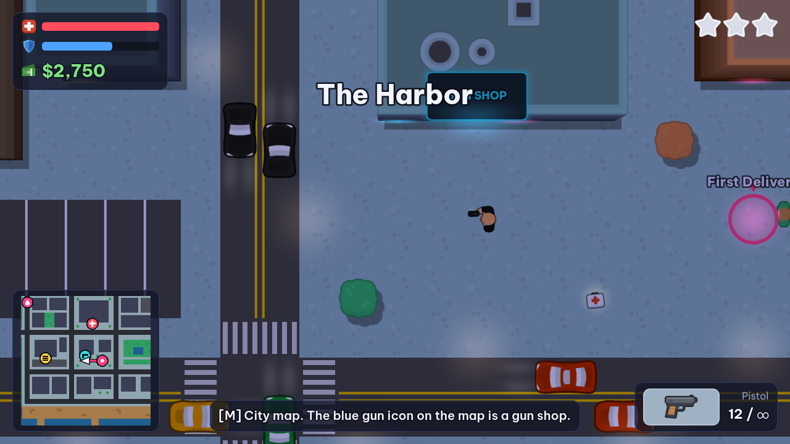 | 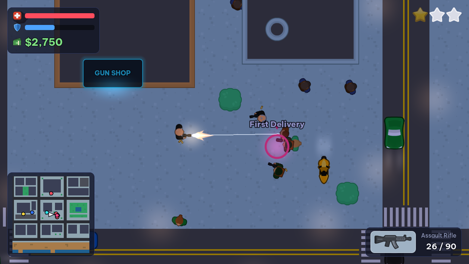 |
| 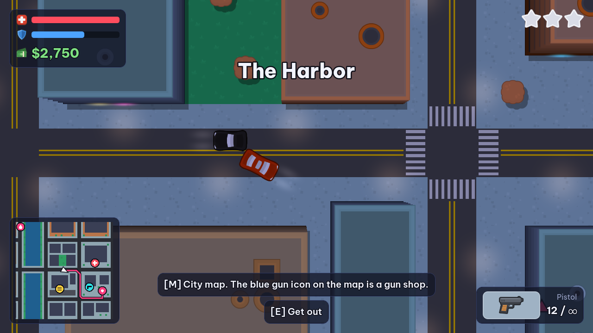 | 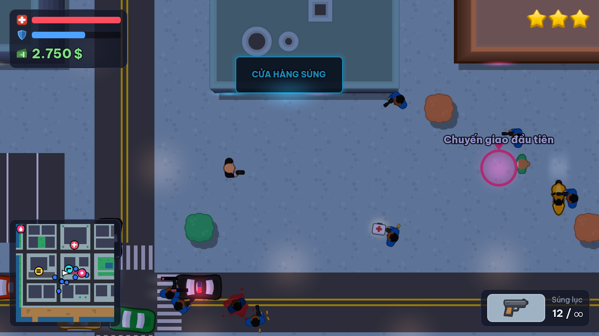 |
| 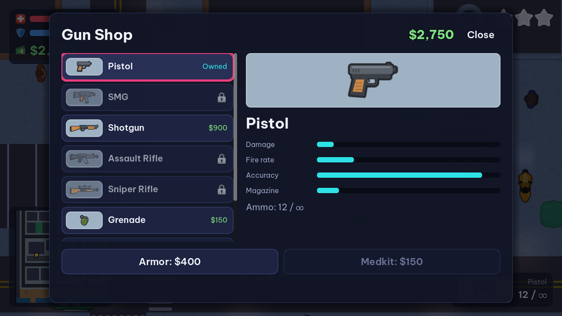 | 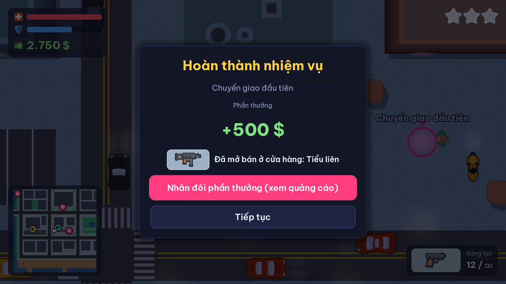 |
| 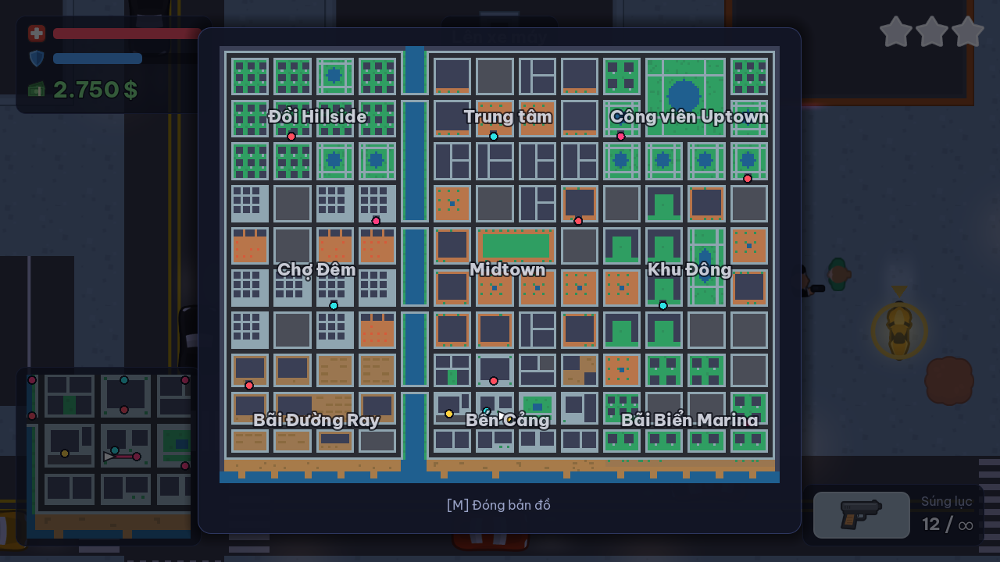 | 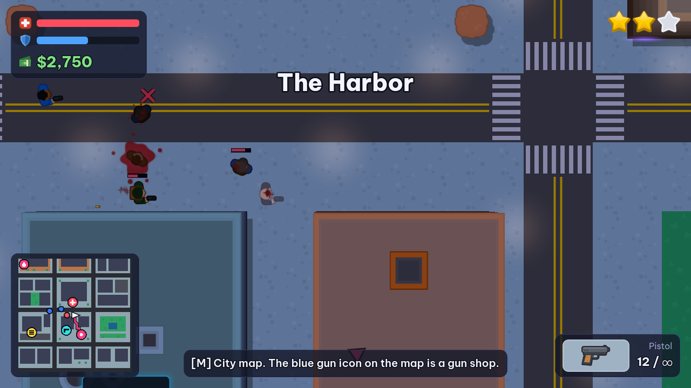 |
| 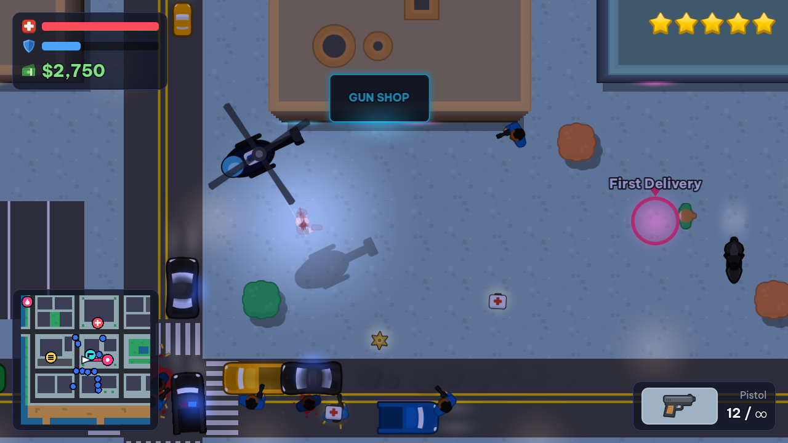 | 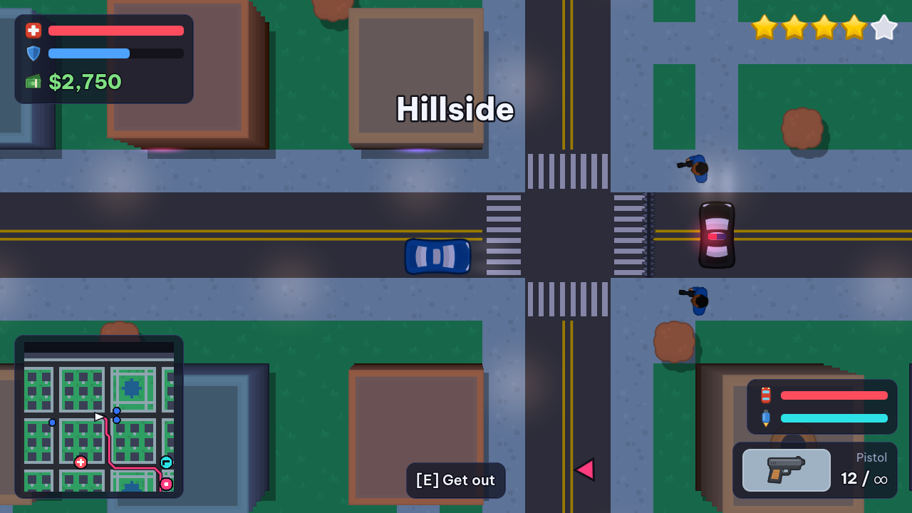 |
| 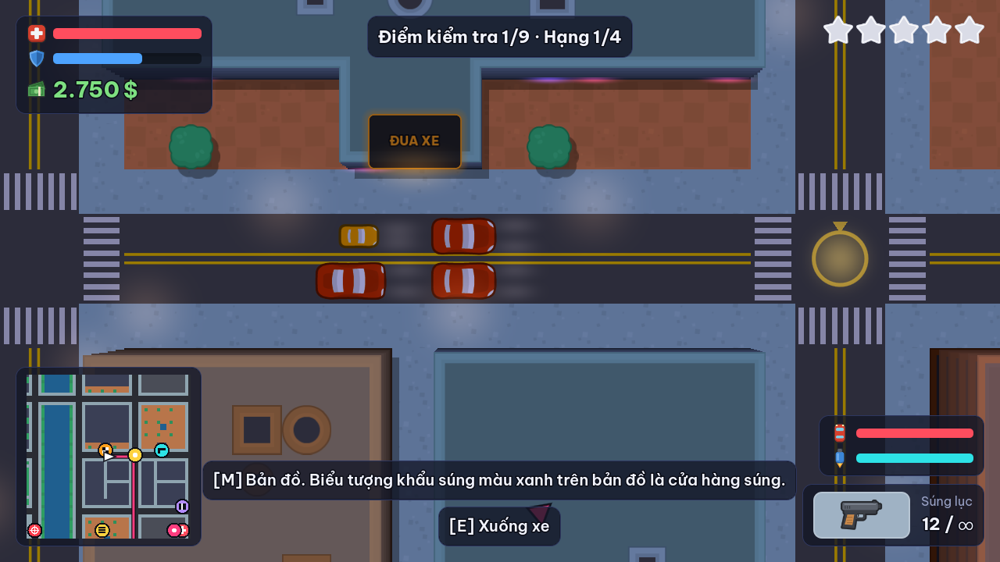 | 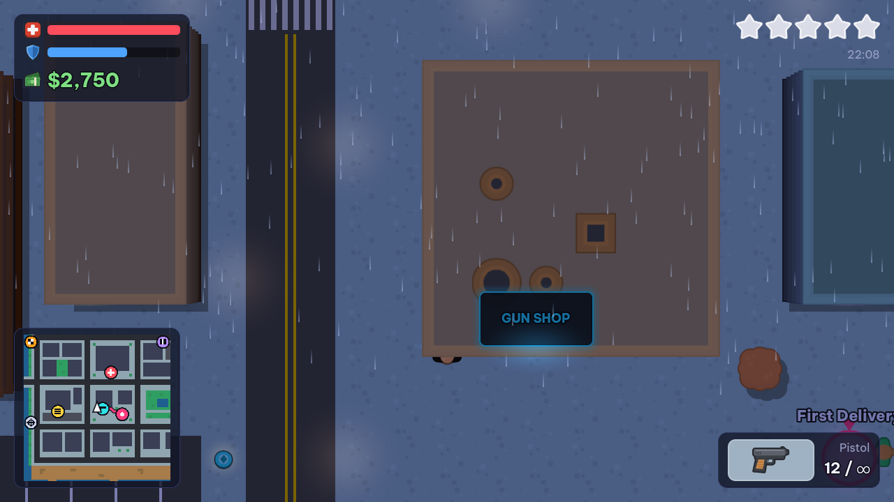 |
| 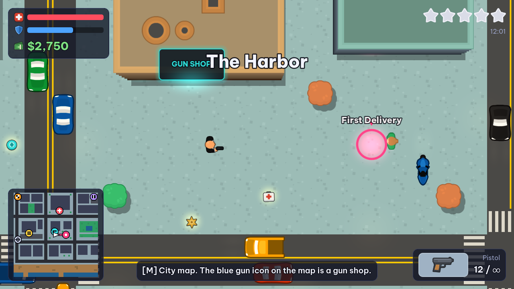 | 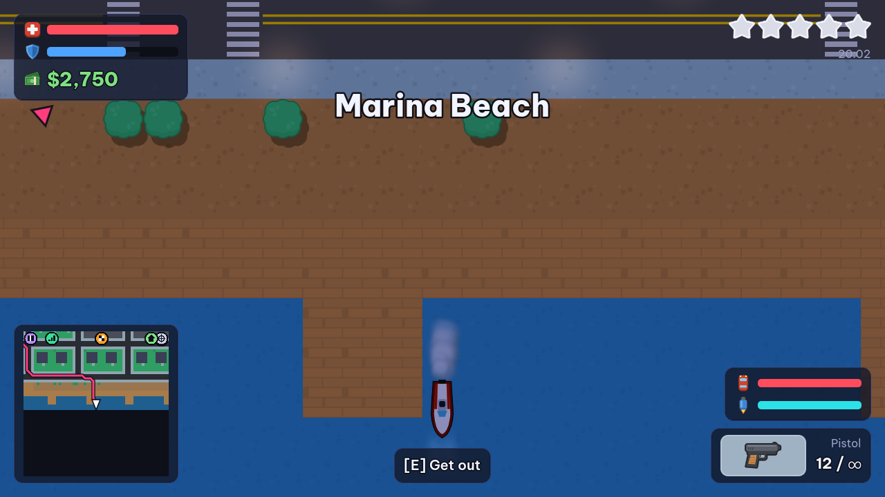 |
| 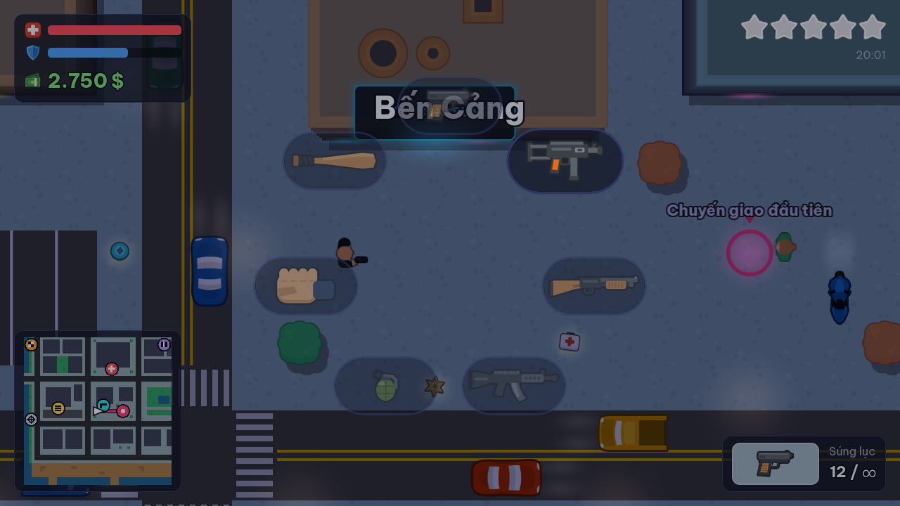 | 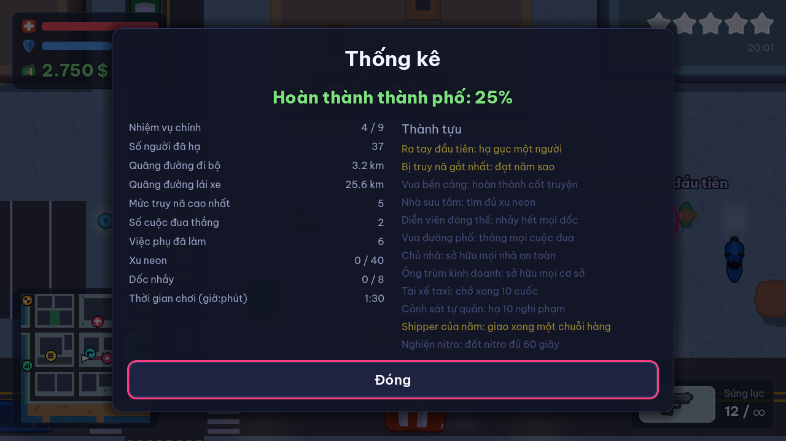 |

## Features

- A 238×186-tile city (nine times the size of the first district) loaded at runtime from an ASCII map
  into `TileMapLayer`s: nine districts (Hillside, Downtown, Uptown Park, Night Market, Midtown, Eastside, Rail Yard,
  The Harbor, Marina Beach), a river crossed by four bridges, and a waterfront. The district name appears when you
  enter it. Building roofs are auto-tiled from Kenney's wall tiles (47 edge/corner shapes in three colours);
  neon strips glow under the eaves and market stalls have canopies you can walk under. Buildings stand out like in
  classic top-down crime games: wall and roof layers scale around the camera centre, so roofs lean away from you and show their walls
  (two building heights), roofs are tinted apart from the road, and buildings, trees and crates cast drop shadows.
- On foot: 10 weapons defined as data (`game/data/weapons.json`): fists and a baseball bat, pistol, SMG, shotgun, assault rifle, sniper rifle (pierces 3 targets), grenades, flamethrower (sets
  targets on fire), rocket launcher. Hold the swap key for a weapon wheel (time slows down while it is open).
  Pistol and SMG can be fired from a moving vehicle (drive-by).
  Melee hits read clearly: Jay lunges, a swing trail sweeps across (white for fists, orange with the bat), the
  game freezes for a split second on impact with sparks and a light shake, and the victim staggers. Three hits in a
  row make a combo whose last blow is stronger and knocks the target down.
  Muzzle flash, ejected casings, tracers, screen shake, knockback and hit flash. Wounded people show a small health
  bar; a takedown is confirmed with a red X and a sound, and the body stays dark on a spreading pool of blood
  (people knocked down by a car get back up instead).
- Vehicles: motorbike, compact, sedan, pickup, taxi, sports car, supercar, police car, SWAT van and speedboats
  (boats stay on the water and bounce off the shore). Nitro (a tank that burns in 2.5 s and refills), horn that
  scares pedestrians out of the way, tyres that burst on police spike strips, eight stunt ramps that pay out by air
  time. The respray shop also repairs the car and fixes burst tyres. Two control schemes (Settings):
  **Arcade** (default) drives like walking — the car turns toward the direction you press, brakes for corners, and
  backs around if you press the opposite way; **Classic** is accelerate/brake plus turning the car body.
  Handbrake drift and skid marks. Crashes damage vehicles; a wrecked vehicle burns and explodes.
- A living city: pedestrians walk the sidewalks and flee from gunfire; some carry a pistol and shoot back when
  attacked, some punch back when you start a fist fight while others cover up and run, carjacked drivers sometimes
  fight, and witnesses phone the police a few seconds after they hear you shoot. Aim a gun at someone (mouse or
  right stick) and they raise their hands; keep aiming and they drop their wallet, which is a crime if anyone sees
  it. Press the interact key next to a pedestrian to talk: greetings, rumours, tips, and now and then a small errand
  (find a dropped package nearby and bring it back for a reward). Emote bubbles show surprise, fear and anger, and
  Red Fangs throw a taunt before they open fire.
- Lucky Live, a self-styled street "influencer" (shaved head, shades, gold chain, phone always recording), streams
  from a corner near the start under a neon sign. Walk close and he talks to his viewers; talk to him for his
  pavement philosophy, and now and then a thief snatches his phone: knock the thief down and bring the phone back
  for a reward (he may "forget his wallet" first). Traffic follows the directed lanes in the map, stops for obstacles and honks. After mission 2 the Red Fangs
  guard their turf (Harbor, Rail Yard, Marina) until the story ends. Population is spawned and despawned off screen.
- Day and night: a full day lasts 16 minutes; the light changes from night to dawn, day and dusk, and street lamps,
  neon and headlights fade out in daylight. Now and then it rains: darker sky, rain on screen, slippery roads.
- Wanted level 1–5 stars. Cops arrive from off screen on foot and by car; at 4 stars SWAT vans and roadblocks with
  spike strips appear ahead of you, at 5 stars a helicopter follows you with a searchlight and fires from above
  (it only sees you inside its light, and it can be shot down). Stay out of sight long enough and the stars go down,
  pick up a bribe badge to drop one star, or drive into a respray shop and pay to lose them at once.
- Side jobs, repeatable: street races against three rivals (three routes, best time saved), courier runs of five
  deliveries, taxi fares whenever you drive a taxi, vigilante patrols in a police car, and turf wars against waves of
  Red Fangs. Forty hidden neon tokens are scattered across the city.
- Property: three safehouses (rest and save, hire up to two bodyguards who follow you and fight, change outfit,
  park one car that stays there between sessions) and four businesses that pay out every in-game midnight.
- Stats screen (from the pause menu) with city completion, distances, takedowns and twelve achievements.
- Street life: pigeons, cats, dogs, seagulls and crabs wander the city and simply run or fly away from you and traffic.
  Animals can never be hurt (bullets, melee and cars pass through them). Pedestrians also chat with each other, and
  react to rain, night and your wanted level.
- Traffic incidents: now and then two cars crash on a road near you. Traffic piles up behind them, honking, while both
  drivers get out, argue, sometimes brawl, make up and drive away.
- How to play screen (main menu and pause menu): a controls page (keyboard, or the touch buttons on phones) and a basics page covering healing, losing the cops, avoiding stars, earning money, cars and water.
- Swimming: Jay can swim slowly (no shooting); stay in the water too long and you start to drown.
- Cheat codes typed on the keyboard (they disable achievements for that save): `NEONGOD` invincible,
  `FULLCLIP` every weapon, `HEATWAVE` one more star, `COOLOFF` lose the cops, `FASTLANE` a supercar,
  `DEADTOWN` zombie night.
- Gun shop with stat bars, armor and medkits (every gun has unlimited ammo, you only reload); locked guns show which mission unlocks them.
- Mission guidance: a GPS route on the minimap (by road when driving) and an arrow at the screen edge.
  Full city map on M / Tab with a legend; gun shops, hospitals, respray shops and the garage each have their own
  icon, and the minimap keeps the nearest one of each pinned to its edge.
- Forgiving difficulty: health regenerates up to 60 after a few seconds without damage, vehicles you drive take
  half crash damage, Rosa hands you an SMG and body armor for mission 2, and a failed mission offers an instant
  retry from its start point.
- Healing: medkits and armor lying around the city (parks, plazas, the stadium, outside the Red Fangs hideout;
  they come back a minute after you take them, and you only pick them up when you need them), small medkits
  dropped by gang members and cops, free full healing when you walk into a hospital door, and medkits in shops.
- Beginner guide on the first game: walk, shoot, open the map, start the first mission, get on the bike, drive,
  where to buy guns. Each step clears when you do it; optional steps time out, and doing something later in the
  list skips ahead. It can be turned back on in Settings.
- When you go down you choose: retry the mission you were on (free), wake up at your nearest safehouse (free,
  stars cleared; only once you own one), get up right there (20% of your cash, wanted level kept, a few seconds of
  protection), or wake up at the nearest of five hospitals (10%, stars cleared).
  You keep your guns. No game over.
- Save in `user://save.json` (IndexedDB on the Web): money, guns, loaded rounds, finished missions, settings,
  time of day, outfit, property, the parked car, stats and achievements.
- English and Vietnamese, switchable at runtime. All on-screen text comes from `game/i18n/strings.csv`.
- No ads in this version.
- Phones (Web): floating sticks that appear under your thumb (left half walks, right half aims and shoots, with aim
  assist on gang members and, when wanted, cops), big round Use / Swap / Reload / Pause buttons, a control-size
  slider in Settings, tap the minimap to open the city map (tap anywhere to close it), and hints/guide that name the touch buttons. Holding the
  phone upright pauses the game and asks you to turn it sideways; the menu has a Full screen button (Android Chrome
  also locks landscape).

## Controls

| Action | Keyboard / mouse | Gamepad |
|---|---|---|
| Move / drive | WASD or arrow keys | Left stick (RT accelerate, LT brake) |
| Aim | Mouse | Right stick |
| Fire | Left mouse button | RT |
| Get in / out of a vehicle | E | A |
| Handbrake | Space | B |
| Nitro | Shift | Y |
| Horn | H | L3 |
| Next / previous weapon | Mouse wheel, Q | RB / LB |
| Weapon wheel | Hold Q | Hold RB |
| Select weapon | 1–9, 0 | |
| Reload | R | X |
| City map | M or Tab | Back |
| Pause | Esc or P | Start |

Walk into a gun shop door to open the shop. Walk into a pink marker to start a mission. Stop your car on a race flag for
a second to start a street race; press E at a courier depot or a turf-war sign to start those jobs, and at a safehouse
or business door to buy it. In a car, E always gets you out.
On phones the Nitro button appears while you drive, and holding Swap opens the weapon wheel.
With the Classic driving scheme, W/S (or RT/LT) accelerate and brake and A/D turn the car.

## Running

```bash
./play.sh                 # runs the Linux export if built, otherwise the project with Godot
./play.sh -- --touch      # force the touch controls on
./play-web.sh             # serves build/web on http://localhost:8060
```

Godot 4.7.2 is expected at `~/games/tools/godot/godot` (or set `GODOT=/path/to/godot`).

## Building

```bash
tools/checks/export.sh    # exports Linux (build/linux/NeonHarbor.x86_64) and Web (build/web/index.html), then tests both
tools/deploy_web.sh       # exports Web and pushes the build to the public GitHub Pages repo
```

Windows and Android presets also exist (`Windows Desktop`, `Android`):

```bash
godot --headless --path game --export-release "Windows Desktop" ../build/windows/NeonHarbor.exe
godot --headless --path game --export-debug "Android" ../build/android/NeonHarbor.apk   # needs the Android SDK + debug keystore in Godot's editor settings
```

**Releases.** Pushing a tag `vX.Y.Z` that matches `config/version` in `game/project.godot` (and `version/code` /
`version/name` in the Android preset) makes CI build and test every platform, sign the APK with the release key kept
in the repository secrets, and publish a GitHub Release with the Windows, macOS, Android and Linux builds
(release notes: `tools/ci/release_notes.txt`). Pull requests run the same checks with a throwaway debug key.

The Android build was checked in the emulator (menu, city, touch sticks); it needs a real GPU (the software-only
emulator GPU fails to compile Godot's canvas shader). The Windows build is exported but not run here.

Export templates for 4.7.2 must be installed. The Web build uses `variant/thread_support=false`, so it needs no
special HTTP headers. `include_filter` packs the non-resource files read at runtime (`maps/*.txt`, `data/*.json`).

## Checks

```bash
tools/checks/check_all.sh   # clean import, map validator, i18n check, font coverage, smoke, missions (all 9),
                            # vehicles, wanted, activities, atmosphere, combat, economy, water, social, touch,
                            # human-like playtest with a random-input phase, gameplay bot reports
                            # (missions 1, 2 and 4–9 played with real physics), reverse tests
tools/checks/take_shots.sh  # real screenshots of every screen in English, Vietnamese and pseudolocalization
NH_HEADED=1 node tools/checks/web_play.mjs http://localhost:8060/index.html reference/shots perf     # Web FPS, full city
NH_HEADED=1 node tools/checks/web_play.mjs http://localhost:8060/index.html reference/shots persist  # save survives a reload
```

## Trailer clips

```bash
tools/trailer/render.sh             # every scene in 9:16, 4:5 and 16:9 → ../neon-harbor-trailer/clips/
ASPECTS=9x16 LANG_CODE=en tools/trailer/render.sh chase dog   # only some scenes, aspects or the English build
```

Scripted scenes (`pigeons`, `incident`, `chase`, `dog`, `night`) recorded with Godot's Movie Maker at a fixed 60 FPS,
so the video is smooth however slow the machine is. The HUD is hidden, the camera zooms for each aspect ratio and the
music is off (game sounds stay). Each MP4 comes with a JSON file of event frames (`honk`, `flock_up`, `stars_3`,
`explosion`...) for placing cuts, captions and sound effects when editing. Needs `ffmpeg` with libx264.

## Web performance and saves

- Measured on an Intel UHD 630 in Chrome with hardware acceleration on an idle machine: 74.7 FPS on average
  (minimum 71) in the worst case (city at its maximum population, 5-star police with helicopter, SWAT and roadblocks, and rain:
  65 vehicles, 18 cops) and 74.3 FPS at 3 stars (minimum 70). The Linux build holds the monitor's 75 FPS in the
  same worst case, and about 65 FPS (minimum 58) while another heavy process loads the machine. Without GPU acceleration the browser falls back to software rendering
  (about 15 FPS), so keep "Use graphics acceleration" on and check that `chrome://gpu` does not say "Software only".
- Serve the build with gzip or brotli: `index.wasm` is 37.7 MB raw, 9.6 MB gzipped.
- Progress is saved to `user://save.json`, which the browser keeps in IndexedDB for that site. It is written after
  missions, purchases, selling a car, settings changes, every 30 seconds while playing, and when the tab loses
  focus. Clearing site data or using a private window loses it.

## Map format

`game/maps/city.txt`, one character per 64 px tile. It is built by `tools/maps/build_city.py` from the
hand-drawn harbor district (`tools/maps/harbor.txt`, where the missions take place) plus block templates for the
other districts, with a fixed seed so the output never changes; the script also writes `game/data/districts.json`.

| Char | Meaning | Char | Meaning |
|---|---|---|---|
| `#` | building (solid, auto-tiled roof) | `T` | tree (solid) |
| `,` | sidewalk | `"` | grass / park |
| `~` | water (solid) | `.` | bare ground |
| `_` | wooden dock | `-` | parking lot |
| `x` | crate (solid) | `> < ^ v` | directed lane (traffic follows it) |
| `+` | intersection | `=` | crosswalk |
| `:` | plaza | `M` | market stall (plaza with a canopy) |
| `P` | player start | `S` | gun shop door (one or more) |
| `H` | hospital (one or more) | `G` | garage (sell cars, mission 3 drop-off) |
| `R` | respray shop (one or more) | `b` | parked motorbike |
| `h` | medkit spot (respawns) | `a` | armor spot (respawns) |
| `1 2 3` | mission start points | `r` | Red Fangs hideout (mission 2) |
| `d` | delivery point (mission 1) | `k` | heist target car (mission 3) |
| `c` | parked car | `m` | the mission 1 motorbike |
| `4`–`9` | mission start points (chapters 2–3) | `w y F i e t` | mission targets (warehouse, bar, fuel depot, informant, safe spot, cash truck) |
| `Z` | safehouse door | `B` | business door (`R` also appears in the Rail Yard since the expansion) |
| `Q` | street race start | `J` | courier depot |
| `K` | turf war start | `o` / `W` | neon token / bribe badge |

The builder also writes `game/data/extras.json`: race checkpoints (intersection centres), stunt ramps (cell and
direction) and boat moorings. New places are stamped on after the old layout with their own seed, so the original
blocks did not move.

`tools/checks/validate_map.py` checks the format, that every important point is reachable on foot from `P`,
that the directed lane network is strongly connected (no dead ends for traffic), that shops, hospitals,
the garage, respray shops, safehouses, businesses and side-job starts sit next to a sidewalk, that race routes
only run along roads, that ramps sit on a lane facing their direction and that boats float next to a pier.

## Project layout

```
game/
  data/          weapons, vehicles, missions, districts, dialog speakers, wall tile table (JSON)
  i18n/          strings.csv (keys,en,vi)
  maps/          city.txt (generated, see Map format)
  scenes/        menu, city, shop, ending
  scripts/
    autoload/    Game (the only game state), I18n, Sfx, Music, Shot (scripted screenshots / perf run)
    actors/      Human, Player, Npc (Pedestrian + PedHoldup/PedTalk, Streamer, Cop, Swat, Gangster, Boss, Ally), Vehicle (+ Nitro,
                 Stunt, BoatHull), Pickup, Emote and Speech bubbles
    combat/      Gun, Combat, Melee (+ SwingArc), Projectile, Fx
    core/        Tuning (all gameplay numbers), InputSetup, DataDB, SaveIO
    missions/    mission runner, the nine missions, side jobs (Activities: race, courier, taxi, vigilante, turf war, errand, phone chase)
    screens/     menu, ending
    trailer/     Trailer (Movie Maker recording run), TrailerScenes, TrailerPilot (drives with real physics)
    ui/          theme, HUD, minimap, shop, dialog, overlays, touch controls
    world/       City, CityMap, MapData, lanes, traffic/chase/race/flee drivers, population, police (roadblocks,
                 helicopter), day/night, weather, ramps, properties, achievements, cheats, camera
  tests/         font_coverage, smoke, missions, vehicles, wanted, activities, atmosphere, combat, economy,
                 water, social, touch, playtest, bot_play, bot_story (real-physics bot through missions 4–9)
tools/
  assets/        scripts that generate the sounds, music, weapon icons, effect sprites, helicopter, boats, ramps,
                 spike strips and tokens, and copy Kenney assets
                 (copy_vendor.sh needs the original Kenney packs in vendor/, which is not in the repository)
  checks/        check_all.sh, validate_map.py, check_i18n.py, take_shots.sh, export.sh, web_play.mjs
  maps/          build_city.py and the hand-drawn harbor.txt
  trailer/       render.sh (trailer clips, see above)
```

All gameplay numbers live in `game/scripts/core/tuning.gd`. Adding a weapon or vehicle is a data change.

## Credits

- Art, UI and UI sounds: [Kenney](https://kenney.nl) — Top-down Shooter, Racing Pack, UI Pack (CC0).
  Licenses copied in `game/assets/vendor/`.
- Fonts (SIL Open Font License 1.1, license files in `game/assets/fonts/`):
  [Be Vietnam Pro](https://github.com/bettergui/BeVietnamPro),
  [Noto Sans](https://github.com/notofonts/latin-greek-cyrillic),
  and a small subset of [Noto Sans Math](https://github.com/notofonts/math) (∞ and arrows only).
- Weapon icons, effect sprites, the helicopter, boats, ramps, spike strips, tokens, sound effects and music are
  generated by the scripts in `tools/assets/`.

All names, places and organisations in the game are fictional.

## License

Neon Harbor is **source-available for noncommercial use**. You may play it, study it, modify it and share your
changes, but not use any part of it commercially.

- **Code** (`.gd` scripts, shaders, tools, tests, build and CI scripts): [PolyForm Noncommercial License 1.0.0](LICENSE).
- **Game content made for this project** (story, dialogue and other text in `game/i18n/strings.csv`, mission and
  world data in `game/data/` and `game/maps/`, the generated music, sound effects, sprites and icon in
  `game/assets/`, and the screenshots): [CC BY-NC 4.0](LICENSE-CONTENT.txt).
- **Third-party assets keep their own licenses:** Kenney art and sounds in `game/assets/vendor/` (CC0) and the fonts
  in `game/assets/fonts/` (SIL Open Font License 1.1). See Credits.
- The name "Neon Harbor" and its logo and icon are not licensed for use in other projects or products.

Contributions are welcome under the terms in [CONTRIBUTING.md](CONTRIBUTING.md).
